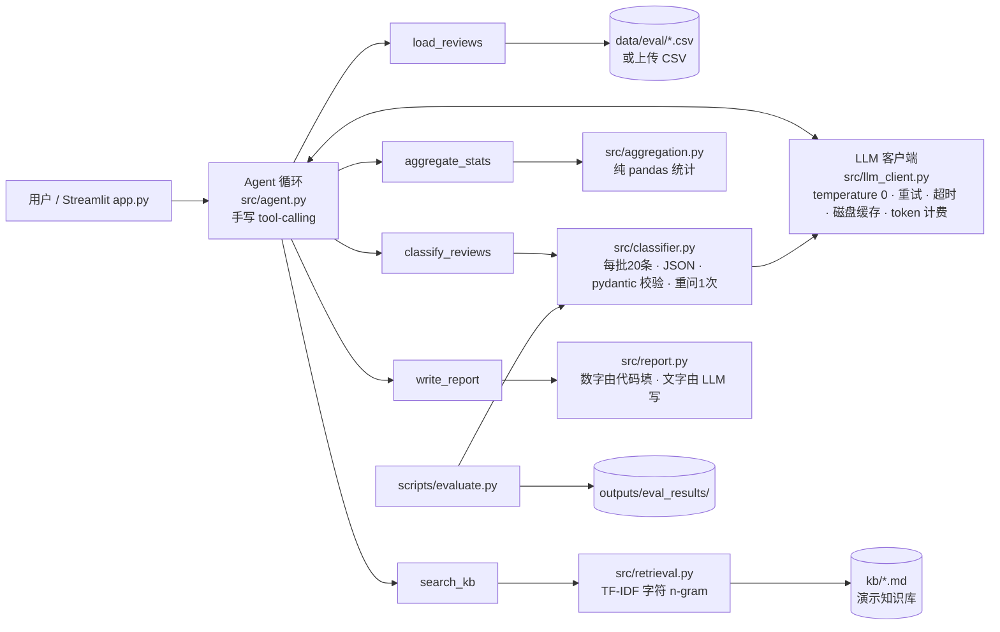

# 个护美妆评论洞察 Agent（beauty-review-agent）

用大模型 + 工具调用（tool calling），把一堆洗发水商品评论变成：**情感与问题标签 → 统计 → 有出处的问答 → 给品牌方的改进报告**。
重点不只是“能跑”，而是**可评测、可复现、数字可追溯**：每个指标都来自 `outputs/eval_results/` 里实际运行保存的结果。

## 1. 业务问题

美妆个护电商每天有大量评论。运营和品牌方真正想知道的是：
- 差评主要集中在哪些问题（假货？漏液？头皮痒？物流？），各占多少？
- 有没有典型原话可以直接拿去和供应链/客服/品牌方沟通？
- 客服或运营被问到成分、头皮类型、售后规则时，能不能快速给出**有出处**的回答，而不是瞎编？

人工读评论慢、口径不统一；本项目用 LLM 做批量分类，用代码做统计，用检索做有出处的问答，并用一套评测证明“分类到底准不准、稳不稳”。

## 2. 架构



| 目录 | 内容 |
|---|---|
| `src/` | `llm_client.py`（LLM 客户端）、`schemas.py`（pydantic 结构）、`prompts.py`（v1/v2 prompt）、`classifier.py`、`aggregation.py`、`retrieval.py`、`tools.py`（5 个工具 + function schema）、`agent.py`（循环）、`report.py` |
| `scripts/` | `prepare_data.py`（下载清洗）、`evaluate.py`（评测）、`run_agent_demo.py`（预置问题）、`tag_agreement.py`（标签人工一致率） |
| `kb/` | 演示知识库：洗发水成分通识、头皮类型、示例售后政策（**均为演示内容**） |
| `data/` | 评测集、holdout 集、标签标注表（原始数据不提交，见 [data/README.md](data/README.md)） |
| `outputs/` | 评测结果、数据质量表、报告、Agent 演示记录、LLM 缓存（用于无 Key 演示） |
| `docs/` | [prompt 迭代记录](docs/prompt_iteration.md)、[面试讲解](docs/面试讲解.md) |
| `tests/` | 35 个 pytest 测试，全部 mock LLM，不调用真实 API |

## 3. 数据

- 来源：公开中文数据集 `online_shopping_10_cats`，来自 GitHub 仓库 [SophonPlus/ChineseNlpCorpus](https://github.com/SophonPlus/ChineseNlpCorpus)（字段 `cat, label, review`；label 1=正向，0=负向）。
- 许可说明：该仓库**没有附带明确的 license 文件**。本项目仅用于学习与作品集演示，不在仓库中再分发完整数据，只提交 600 条评测/holdout 样本；商用请先联系原作者。
- 只保留 `cat == "洗发水"`，清洗过程（`outputs/data_quality.md`）：

| 步骤 | 剩余行数 | 本步移除 |
|---|---:|---:|
| 原始数据（全部10个品类） | 62774 | 0 |
| 仅保留 cat == 洗发水 | 10000 | 52774 |
| 去除空评论（strip后为空/缺失） | 10000 | 0 |
| 去除标签冲突的重复文本 | 10000 | 0 |
| 去除完全重复的评论 | 10000 | 0 |
| 去除近似重复（忽略空格/标点后相同） | 9984 | 16 |
| 清洗后标签分布：正向 4992 / 负向 4992 | 9984 | 0 |

- 评测集 `data/eval/eval_set.csv`：300 条，正/负各 150，`random_state=42`。
- Holdout 集 `data/eval/holdout_set.csv`：另外 300 条（正/负各 150），与评测集不重叠，写 prompt 时从未查看，只用于检查泛化。

## 4. 评测结果（真实运行）

模型 `deepseek-chat`，temperature=0。预测为“中性”一律算错（金标准只有正/负）。详见 [docs/prompt_iteration.md](docs/prompt_iteration.md)。

| 指标 | v1 评测集 | v2 评测集 | v1 holdout | v2 holdout |
|---|---:|---:|---:|---:|
| 准确率 | 90.33% | **98.00%** | 90.00% | **95.67%** |
| Macro-F1（正/负） | 0.9466 | **0.9832** | 0.9414 | **0.9663** |
| 中性率 | 9.33% | 0.67% | 9.00% | 2.00% |
| 非中性样本准确率 | 99.63% | 98.66% | 98.90% | 97.62% |
| JSON 失败率（重问1次后） | 0.00% | 0.00% | 0.00% | 0.00% |
| 稳定性（关缓存跑两次，情感+标签完全相同） | 95.67% | 94.67% | 未测 | 未测 |

要点：
- v1 的 29 个错误中有 28 个是“判成中性”。原因是数据标签代表“整体满意度（星级）”，而 v1 把“还没用，等追评”当成中性。v2 重新定义了情感，并规定“夸产品但抱怨平台/价格 = 负向”。
- v2 是看着评测集 badcase 写的，评测集提升 +7.67 个百分点**偏乐观**；holdout 上 +5.67 个百分点更可信。
- v2 新引入了 3 个错误（长评论里抱怨的是别的商品/别的平台），稳定性也没有提升。这些写在了“下一步”里。
- **问题标签没有人工金标准，因此不报告标签准确率**。已准备 50 条标注表，见第 7 节。

API 花费（`outputs/usage_log.jsonl`，按 DeepSeek 未命中缓存价 ¥2/百万输入 token、¥3/百万输出 token **估算**，请以官网价格为准）：本项目全部实验共 116 次 API 调用、约 12.9 万输入 token + 5.5 万输出 token，**约 ¥0.42**。重复运行命中缓存，不再花钱。

## 5. 如何运行（Windows / PowerShell）

```powershell
# 1. 环境（Python 3.10+）
python -m venv .venv
.venv\Scripts\pip install -r requirements.txt

# 2. 不需要 API Key 也能看：演示模式（读取缓存与已保存结果）
.venv\Scripts\streamlit run app.py

# 3. 想自己调用模型：配置 Key
copy .env.example .env        # 然后在 .env 里填 LLM_API_KEY（不要提交 .env）

# 4. 下载并清洗完整数据（可选；评测集已在仓库里）
.venv\Scripts\python scripts\prepare_data.py

# 5. 评测
.venv\Scripts\python scripts\evaluate.py --version v2 --stability
.venv\Scripts\python scripts\evaluate.py --version v2 --set holdout

# 6. Agent 预置问题（会打印每一步调用了什么工具）
.venv\Scripts\python scripts\run_agent_demo.py

# 7. 测试（mock LLM，不花钱）
.venv\Scripts\python -m pytest -q
```

环境变量（`.env`）：`LLM_API_KEY`、`LLM_BASE_URL`（默认 `https://api.deepseek.com`）、`LLM_MODEL`（默认 `deepseek-chat`），任何 OpenAI 兼容接口都可以用。

App 三个页面：
1. **评论分析**：选择示例数据或上传 CSV（需包含 `review` 列）→ 分类 → 情感/标签图表、负向 Top 问题原话、逐条结果表、可下载的 Markdown 报告。
2. **问答助手**：和 Agent 对话；展开可以看到每一步调用了哪个工具、参数和返回结果，以及检索到/引用了哪些知识库文件。演示模式下只能回答 5 个预置问题。
3. **评测结果**：v1 vs v2 指标、holdout 泛化检查、混淆矩阵、稳定性、badcase 浏览。

## 6. 设计要点

- **手写 tool-calling 循环**（不用 LangChain 等框架）：`src/agent.py` 不到 100 行，模型每一步调了什么工具都看得见、测得到。
- **固定标签体系**（13 个）：pydantic 校验，标签不在体系内就重问，保证统计口径稳定、可以按月对比。
- **数字由代码算，文字由模型写**：报告里的数量、占比、原话全部由 `aggregation.py` 统计后填入；LLM 只写“关键发现”和“建议”，并要求只能引用给定数字。
- **知识库问答必须带出处**：`search_kb` 返回文件名；检索不到时工具会明确返回“知识库中没有找到相关内容”，Agent 会说“知识库中没有相关信息”，不会瞎猜，也不给医疗建议。
- **TF-IDF 字符 n-gram 检索**：知识库只有 16 个段落，TF-IDF 足够、可解释、零成本、无需额外模型。
- **磁盘缓存**：key = (prompt 版本, 模型, 输入)，重复运行零成本；同时让没有 Key 的人也能用演示模式浏览全部结果。

## 7. 待办：标签人工标注

`data/eval/tag_labeling_sheet.csv` 有 50 条评论（不显示模型标签，避免影响判断）。用 Excel 填 `human_tag_1`（必填）和 `human_tag_2`（可选），然后：
```powershell
.venv\Scripts\python scripts\tag_agreement.py --version v2
```
会输出完全一致率、有交集率、平均 Jaccard、每个标签的精确率/召回率。

## 8. 局限

- **只有一个品类**（洗发水），且数据是公开语料，没有商品/品牌/时间字段，无法做分 SKU 或趋势分析。
- **金标准是二分类**，没有“中性”，也没有标签金标准；情感评测只能衡量“和星级口径是否一致”。
- 数据集正负样本是人为平衡的（各约 50%），所以报告里的正/负占比**不代表真实好评率**。
- 评测集只有 300 条，1 条评论 ≈ 0.33 个百分点，小差异不一定显著。
- 知识库是**演示内容**，只有 3 个文件；TF-IDF 依赖字面重合（例如“假货”和“真伪”一开始匹配不上，需要在知识库里补充用户常用说法）。
- 问答助手每个问题独立运行，没有多轮记忆。
- 成本估算基于假设的单价，未区分 DeepSeek 的缓存命中价。

## 9. 下一步

1. prompt v3：区分“对这一单的抱怨”和“对别的商品/平台/过去经历的抱怨”；长评论以总结句为准；在单独的 dev 集上挖 badcase，避免对评测集过拟合。
2. 完成 50 条标签人工标注，根据一致率调整标签体系和定义。
3. 扩展到更多品类（护发素、面霜等），标签体系按品类配置。
4. 知识库变大后改用 embedding 或“TF-IDF + embedding”混合检索，并建立检索评测集（问题 → 应命中的段落）。
5. 接入真实店铺数据后，按 SKU/周做趋势监控，差评某个标签突增时自动预警。
